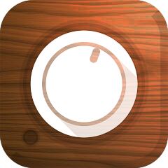

# AveeCraft
<p align="center">
  
</p>

**AveeCraft** is a self-contained, cross-platform Java & OpenGL desktop audio visualizer editor, `.viz` template studio, and hardware-accelerated video exporter ported from Android **Avee Player** (`v1.2.101`).

## Features

- **Android-Faithful OpenGL Visualizer Engine**: Ported GLES20 rendering pipeline with 18 built-in presets, real-time spectrum/waveform/beat reactivity, premultiplied-alpha compositing, custom shaders, blur/motion-blur/RGB-split effects, dynamic album-art gradient generation, and layer selection highlight flash.
- **Scene Hierarchy & Property Inspector**: Inspect, add, reorder, duplicate, toggle visibility, and live-edit compositions, elements, measure curves, blend modes, images, animated GIFs, and video layers.
- **Full `.viz` & JSON Compatibility**: Open and save `.viz` ZIP archives (including bundled local media assets) as well as raw `scene.json` files compatible with Android Avee Player templates.
- **GPU-Accelerated Video Export**:
  - **GPU Selector**: Switch between **Auto**, **Integrated GPU** (Intel VA-API on Linux / QuickSync on Windows), **External / Dedicated GPU** (NVIDIA NVENC), or **CPU Software** (`libx264` / `libx265`) — steering both OpenGL rendering and video encoding.
  - **Fast Async PBO Pipeline**: Offscreen FBO rendering + GPU-side Y-flip (`glBlitFramebuffer`) + double-buffered async Pixel Buffer Object (`GL_PIXEL_PACK_BUFFER`) DMA readback streamed directly to `ffmpeg`.
  - **Export Settings**: Presets (`1080p @60`, `1080p @30`, `720p @60`, `720p @30`, `1080x1920 Vertical`, `2160p 4K @60`, `Custom`), H.264 / HEVC codecs & profiles, bitrate, HQ blur toggle, hide app logo toggle, stereo AAC audio & start/end time range, 5s quick preview export, and live FPS/ETA progress monitor.

## Download & Run Standalone Binaries

GitHub Actions ([`.github/workflows/build.yml`](.github/workflows/build.yml)) produces fully **standalone** portable archives and native installers for Windows (`x64`) and Linux (`x64`) with **OpenJDK 21 runtime and FFmpeg/FFprobe bundled** — no separate Java or FFmpeg installation is required:

| Platform | Type | Artifact | Launch / Install |
|---|---|---|---|
| **Windows 10/11 (x64)** | Setup Installer | `AveeCraft-windows-x64-setup.exe` | Run installer wizard (Start Menu & optional Desktop shortcut) |
| **Windows 10/11 (x64)** | Portable Archive | `AveeCraft-windows-x64-standalone.zip` | Extract and run `AveeCraft.exe` |
| **Linux (Debian / Ubuntu)** | `.deb` Package | `AveeCraft-linux-amd64.deb` | `sudo apt install ./AveeCraft-linux-amd64.deb` |
| **Linux (Universal x64)** | Portable Archive | `AveeCraft-linux-x64-standalone.tar.gz` | Extract and run `./bin/AveeCraft` |

### Optional GPU Drivers (for Hardware Export)

- **NVIDIA**: Recent NVIDIA proprietary driver for `h264_nvenc` / `hevc_nvenc` (on Linux PRIME laptops, **External GPU** sets `__NV_PRIME_RENDER_OFFLOAD=1` and `__GLX_VENDOR_LIBRARY_NAME=nvidia` automatically).
- **Intel / AMD Integrated**: Mesa + VA-API (`libva` / `intel-media-driver`) on Linux (`h264_vaapi` / `hevc_vaapi`), or Intel QuickSync / AMD AMF drivers on Windows.

## Build & Verify from Source

### Prerequisites

- **JDK 21** (Eclipse Temurin or equivalent OpenJDK 21 with `jpackage`)
- **FFmpeg / FFprobe** on `PATH` (for running from source or `./gradlew verifyEditor`)

### Run & Test

```bash
# Run AveeCraft desktop editor
./gradlew run            # Linux / macOS
gradlew.bat run          # Windows

# Run automated verification (18 presets, audio decode, GIF playback, highlight flash, GPU/CPU export + ffprobe)
./gradlew verifyEditor   # Linux / macOS
gradlew.bat verifyEditor # Windows
```

### Build Local Standalone Package

Place `ffmpeg` + `ffprobe` (or `ffmpeg.exe` + `ffprobe.exe` on Windows) into `build/package-input/ffmpeg/` after `stagePackageInput` to bundle them into the standalone binary:

```bash
./gradlew stagePackageInput generateWindowsIcon

# Optional: copy ffmpeg & ffprobe binaries into build/package-input/ffmpeg/
# then bundle with jpackage (Linux example):
jpackage \
  --type app-image \
  --name AveeCraft \
  --app-version 1.0.0 \
  --icon src/main/resources/drawable/aveecraft.png \
  --input build/package-input \
  --main-jar AveeCraft-1.0.0.jar \
  --main-class com.daaw.avee.editor.AveeEditorApp \
  --add-modules java.base,java.desktop,java.logging,java.management,java.naming,java.sql,java.xml,jdk.unsupported \
  --dest build/jpackage
```

To target another OS's LWJGL / Dear ImGui native artifacts explicitly, pass `-PtargetOs=windows`, `-PtargetOs=linux`, or `-PtargetOs=macos`.

## Credits & Acknowledgements

AveeCraft is built on top of and inspired by the following open-source projects, tools, and assets:

- **Avee Player (`v1.2.101`) & `avee-re`** — Original Android visualizer architecture, GLSL shaders, `.viz` preset format, DSP spectrum analyzer logic, and bundled UI/shader/preset assets by **Daaw** (`DaawSoft`), with reverse-engineering and community mod enhancements in [`TheCubiq/avee-re`](https://github.com/TheCubiq/avee-re).
- **[LWJGL 3](https://www.lwjgl.org/) (`3.4.1`)** — Java bindings for **GLFW**, **OpenGL**, and **Tiny File Dialogs (`tinyfd`)** (`org.lwjgl:lwjgl`, `lwjgl-glfw`, `lwjgl-opengl`, `lwjgl-tinyfd`).
- **[Dear ImGui](https://github.com/ocornut/imgui)** by Omar Cornut — Immediate-mode graphical user interface library powering the desktop editor workspace.
- **[imgui-java](https://github.com/SpaiR/imgui-java) (`1.87.7`)** by SpaiR — Java JNI bindings and LWJGL3 backend for Dear ImGui.
- **[JSON-java (`org.json`)](https://github.com/stleary/JSON-java) (`20240303`)** — JSON serialization/deserialization for presets and `scene.json`.
- **[FFmpeg / FFprobe](https://ffmpeg.org/) & [BtbN FFmpeg-Builds](https://github.com/BtbN/FFmpeg-Builds)** — Static prebuilt FFmpeg/FFprobe binaries bundled inside the standalone distributions for audio decoding, video-frame decoding, hardware-accelerated video encoding (`NVENC`, `VA-API`, `QuickSync`, `AMF`), software `libx264` / `libx265` / `AAC` encoding, and MP4 muxing.
- **[Eclipse Temurin OpenJDK 21](https://adoptium.net/) & `jpackage`** — Java 21 runtime, toolchain, Linux `.deb` packager, and standalone app-image bundler.
- **[Inno Setup](https://jrsoftware.org/isinfo.php)** — Windows installer (`AveeCraft-windows-x64-setup.exe`) packager.
- **[Gradle](https://gradle.org/) (`9.7.1`)** — Cross-platform build automation and wrapper.
- **Bundled Fonts & Media**: `Noto Mono`, `Orbitron`, `Orkney`, `Great Vibes` (bundled in `src/main/resources/fonts/`), plus OS system fonts (`Noto Sans`, `DejaVu Sans`, `Segoe UI`, `Arial`) used for Unicode UI glyph rendering and text album art, and the bundled test audio sample (`src/main/resources/samples/music.mp3`).
